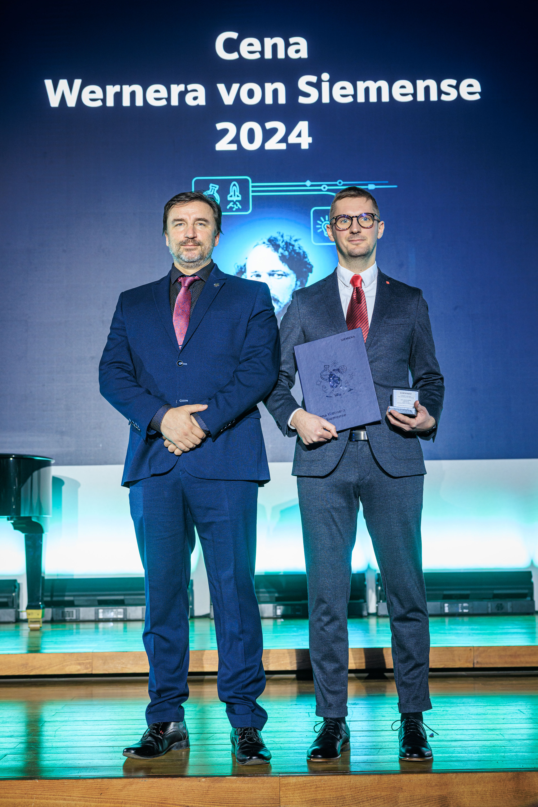

# Design of Advanced Methods in the Field of Industrial Robotics Fitting into the Concept of Industry 4.0

**Ph.D. Thesis** · Roman Parák · Brno University of Technology, 2024

Supervisor: Prof. Radomil Matoušek
Institute of Automation and Computer Science, Faculty of Mechanical Engineering, Brno University of Technology

🏆 **Winner of the Werner von Siemens Prize 2024 for the Best Doctoral Thesis on Industry 4.0**

<p align="center">
  
</p>

---

## Abstract

Robotic manipulators have become increasingly important in both engineering practice and scientific research. This growth is driven by technologies such as autonomous robotics, digital twins, and complex system integration, combined with advances in artificial intelligence. However, existing solutions are often tailored to a specific manipulator type and a single task, which limits their modularity, reproducibility, and potential for future extension.

This dissertation addresses that limitation by designing and developing advanced methods in industrial robotics aligned with the principles of Industry 4.0. The main contributions are:

- **Kinematics** – comprehensive kinematic solutions for a wide range of robotic manipulators, including under-articulated, articulated, and over-articulated (redundant) structures.
- **Motion planning** – motion planning strategies for these manipulators, including novel approaches based on **reinforcement learning**.
- **Collision avoidance** – a computationally efficient collision-detection structure that prevents both collisions with external objects and self-collisions.
- **Industry 4.0 robotic workstation** – the design of a versatile workstation featuring vertical system integration, enabling seamless interoperability between its heterogeneous components.
- **User interface and simulation** – a user interface and a custom simulation tool built on **Unity3D**.

Throughout the work, particular emphasis is placed on versatility, extensibility, and educational use. The thesis aims to advance the field of industrial robotics while also supporting its adoption in teaching and training.

---

## Award

The thesis received the **Werner von Siemens Prize 2024 for the Best Doctoral Thesis on Industry 4.0**. The award was presented at the Bethlehem Chapel in Prague by Prof. Ing. Vladimír Mařík (Czech Institute of Informatics, Robotics and Cybernetics, CTU) and Ing. Lukáš Vlček, Minister of Industry and Trade of the Czech Republic.

<p align="center">
  
</p>

**Further information:**

- [Siemens press release – Werner von Siemens Prize 2024 winners](https://www.siemenspress.cz/ceny-wernera-von-siemense-2024-udeleny-nejlepsim-studentum-mladym-vedcum-a-pedagogum/) (Czech)
- [Brno University of Technology news article](https://www.vut.cz/en/but/news-f19528/werner-von-siemens-prizes-2024-but-celebrates-success-with-four-award-winners-d284514)
- [Video: Werner von Siemens Prize for the Best Doctoral Thesis on Industry 4.0](https://www.youtube.com/watch?v=QfBAgsSy1aQ)

---

## Citation

If you use this work in your research, please cite it as follows:

```bibtex
@phdthesis{RP_PhD_2024,
  title   = {Design of Advanced Methods in the Field of Industrial Robotics Fitting into the Concept of Industry 4.0},
  author  = {Roman Par{\'a}k},
  year    = {2024},
  month   = {March},
  school  = {Brno University of Technology, Faculty of Mechanical Engineering, Institute of Automation and Computer Science},
  address = {Brno, Czechia},
  type    = {Ph.D. thesis},
  url     = {https://example.com/thesis.pdf}
}
```

---

## Contact

**Roman Parák** – [Roman.Parak@outlook.com](mailto:Roman.Parak@outlook.com)
